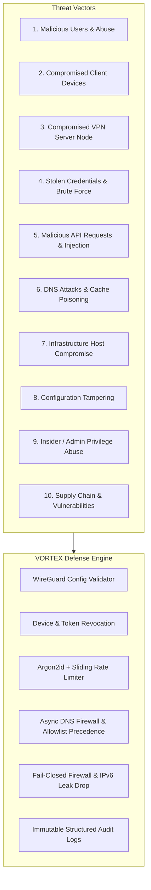

# VORTEX VPN — Comprehensive Threat Model & Security Assurance Specification

This threat model outlines the attack surfaces, threat actors, defensive mitigations, verification test regimes, and telemetry monitoring policies for VORTEX VPN across its 8 core components:
1. 📱 Android (`android/`)
2. 💻 Windows Client (`windows-client/`)
3. 🐧 Linux Client (`linux-client/`)
4. 🌐 Product Website (`website/`)
5. ☁️ FastAPI Control Plane (`backend/`)
6. 🔐 WireGuard VPN Cryptography (`backend/app/services/crypto_service.py`, `wireguard_validator.py`)
7. 🛡️ DNS Privacy Shield Firewall (`dns-blocker/`)
8. 🌍 Global VPN Fleet Nodes (`server-agent/`)

---

## 🛡️ Core Security Principles

1. **Secure by Design**: Cryptographic primitives rely exclusively on audited WireGuard standards (Curve25519, ChaCha20-Poly1305, BLAKE2s). No custom cryptographic algorithms or proprietary tunneling protocols are permitted.
2. **Least Privilege & Role-Based Access Control**: Separation between administrative operations, server agents, and standard client sessions.
3. **Defense in Depth**: Every layer (Client UI -> Network Interface -> API Control Plane -> DNS Firewall -> VPN Node) performs independent cryptographic validation and integrity checks.
4. **Fail-Closed Default**: If WireGuard handshake fails, DNS leaks are detected, or server agents disconnect, network traffic is blocked immediately to prevent cleartext exposure.
5. **Data Minimization (Zero Browsing Logs)**: No user browsing history, destination URLs, page content, or unencrypted DNS requests are recorded. Only aggregate counters are maintained.

---

## 🔍 The 10 Threat Scenarios: Identify → Mitigate → Test → Monitor



---

### Threat 1: Malicious Users & Fleet Abuse
* **Identify**: Malicious users attempting port scanning, distributed denial of service (DDoS), or spamming outbound from VPN egress IPs.
* **Mitigate**: 
  - Dynamic sliding-window rate limiting on all API endpoints.
  - Port isolation on VPN server nodes: egress SMTP (TCP port 25) blocked at `nftables` level to prevent spam relays.
  - Multi-tenant client isolation via WireGuard `AllowedIPs = 10.8.0.x/32` ensuring clients cannot communicate with or scan each other.
* **Test**: Verified by `test_rate_limiting_brute_force_lockout` and multi-tenant IP allocation tests.
* **Monitor**: Server agent monitors bandwidth rate (`bandwidth_usage_mbps`) and active peer counts (`active_connections`). Alerts triggered if traffic exceeds 800 Mbps threshold.

---

### Threat 2: Compromised Client Devices
* **Identify**: A user device is lost, stolen, or infected with malware, and the adversary attempts to use the saved WireGuard keypair or session token to access the network.
* **Mitigate**:
  - Independent WireGuard keypair per device.
  - Centralized Device Revocation (`DELETE /api/v1/devices/{id}`) immediately marks `is_active = False`.
  - The control plane checks device revocation status before every connection handshake. Revoked devices receive `HTTP 403 Forbidden`.
  - Active tunnel sessions for revoked devices are instantly severed.
* **Test**: Verified by `test_revoked_device_connection_prevented` in `test_security_audit.py`.
* **Monitor**: `AuditEvent` logged with action `DEVICE_REVOKED` and client IP anonymized.

---

### Threat 3: Compromised VPN Server Node
* **Identify**: An attacker gains access to a single regional VPN server node (e.g. Frankfurt or Mumbai) and attempts to pivot to other servers or compromise user cryptographic identities.
* **Mitigate**:
  - Complete control plane separation: server nodes do NOT store database credentials, user password hashes, or control plane master keys.
  - Ephemeral client key generation: WireGuard key exchange provides Perfect Forward Secrecy (PFS).
  - Server private keys are isolated strictly to local server memory/keyfiles (`/etc/wireguard/wg0.key`). The central database stores ONLY server public keys. Compromise of the central API does not compromise server private keys, and compromise of a node does not reveal client private keys.
* **Test**: Verified by `test_server_private_key_confidentiality` in `test_security_audit.py`.
* **Monitor**: Remote server agent health heartbeat every 30s. If a node fails heartbeats or reports degraded state, it is immediately dropped from the `AUTO / FASTEST` server rotation pool.

---

### Threat 4: Stolen Credentials & Brute-Force Attacks
* **Identify**: Adversary attempts credential stuffing or dictionary attacks against user login endpoints (`/api/v1/auth/login`).
* **Mitigate**:
  - Password hashing with **Argon2id** (`time_cost=3`, `memory_cost=65536`, `parallelism=4`, `hash_len=32`).
  - IP-based sliding-window rate limiting on `/auth/login` (maximum 5 failed attempts per minute before lockout).
  - Cryptographically signed JWT tokens with 60-minute expiration and short-lived refresh tokens.
  - Instant token revocation via in-memory and database blacklist (`revoke_token()`).
* **Test**: Verified by `test_user_registration_and_login` and `test_revoked_jwt_token_rejection`.
* **Monitor**: Failed login attempts logged to audit trail. Consecutive failures trigger exponential backoff.

---

### Threat 5: Malicious API Requests & Injection Attacks
* **Identify**: SQL injection (SQLi), cross-site scripting (XSS), server-side request forgery (SSRF), or path traversal payloads passed to query parameters or body schemas.
* **Mitigate**:
  - Strict Pydantic V2 schema validation rejecting unexpected types or over-sized payloads.
  - SQLAlchemy 2.0 ORM with 100% parameterized queries. Zero raw string concatenation in SQL queries.
  - Security headers enforced on every HTTP response:
    - `X-Content-Type-Options: nosniff`
    - `X-Frame-Options: DENY`
    - `Strict-Transport-Security: max-age=31536000; includeSubDomains`
    - `Content-Security-Policy: default-src 'self' ...`
* **Test**: Verified by `test_sql_injection_resilience_in_server_filters` in `test_security_audit.py`.
* **Monitor**: Web application firewall (WAF) and FastAPI request validation error metrics.

---

### Threat 6: DNS Attacks, Hijacking & DNS Leaks
* **Identify**: ISP or local network hijacking DNS requests, DNS cache poisoning, or malicious ads/trackers stealing user session cookies.
* **Mitigate**:
  - Internal DNS Shield proxy running directly on the VPN tunnel gateway (`10.8.0.1`).
  - Strict WireGuard config synthesis mandating `DNS = 10.8.0.1`.
  - DNS pre-flight verification: the client UI verifies DNS routing to `10.8.0.1` before marking connection state as `PROTECTED`.
  - Upstream resolution exclusively forwarded to privacy-hardened encrypted resolvers (Quad9 `9.9.9.9` with DNSSEC validation, Cloudflare `1.1.1.1`).
  - Zero logging of unblocked queries; only aggregate threat block counters retained.
* **Test**: Verified by `test_wireguard_config_validator_missing_dns` and `test_domain_blocklist_matching`.
* **Monitor**: DNS firewall telemetry reports total ads, trackers, and malware blocked daily.

---

### Threat 7: Infrastructure Host Compromise
* **Identify**: Adversary attempts to exploit OS vulnerabilities on server nodes or control plane containers.
* **Mitigate**:
  - Containerization using non-root user execution (`USER appuser`).
  - Minimal container base images (`python:3.13-slim` / `alpine`).
  - Read-only root filesystems where applicable.
  - Dropped Linux capabilities (`cap_drop: ALL`, adding only `NET_ADMIN` where WireGuard interface requires).
  - SSH key authentication only (passwords disabled, root login disabled).
* **Test**: Dockerfile linting and automated container vulnerability scans.
* **Monitor**: Host intrusion detection and monitoring agent alerts on abnormal CPU, RAM, or connection surges.

---

### Threat 8: WireGuard Configuration Tampering
* **Identify**: Tampered WireGuard `.conf` injected into client disk or network transit to hijack routing or weaken encryption.
* **Mitigate**:
  - `WireGuardConfigValidator` performs pre-flight cryptographic validation:
    - Verifies 32-byte Base64 Curve25519 private and public keys.
    - Prevents key symmetry (client private key cannot equal peer public key).
    - Requires non-zero entropy keys (rejects all-zero keys).
    - Validates IPv4/IPv6 CIDRs and endpoint UDP port bounds.
    - Rejects configurations missing mandatory DNS directive.
* **Test**: Verified by `test_wireguard_config_validator_tampered_key`, `test_wireguard_config_validator_key_symmetry_violation`, and `test_wireguard_config_validator_port_out_of_range`.
* **Monitor**: Client logs `SECURITY CHECK FAILED` and immediately aborts tunnel activation if validation fails.

---

### Threat 9: Insider / Admin Privilege Abuse
* **Identify**: Unauthorized staff or compromised administrator credentials used to access sensitive telemetry or tamper with server allocations.
* **Mitigate**:
  - Strict Role-Based Access Control (RBAC): endpoints protected by `get_current_admin_user` dependency verifying `user.is_admin is True`.
  - Immutable audit logging (`AuditEvent` model) records every administrative action, timestamp, target entity, and admin identity.
  - Zero user browsing history stored in database: even administrators with full database access cannot view user browsing destinations.
* **Test**: Verified by `test_admin_authorization_bypass_prevention` in `test_security_audit.py`.
* **Monitor**: Administrative audit events monitored and alerted on unusual activity.

---

### Threat 10: Supply Chain & Dependency Vulnerabilities
* **Identify**: Vulnerable third-party Python packages, outdated cryptography libraries, or compromised upstream dependencies.
* **Mitigate**:
  - Pinned dependency versions in `pyproject.toml` and lockfiles.
  - Automated dependency vulnerability scanning (`pip-audit` / GitHub Dependabot).
  - Use of high-assurance libraries: `cryptography` (backed by OpenSSL/BoringSSL) and `argon2-cffi`.
* **Test**: Continuous integration automated scan pipeline.
* **Monitor**: Security advisory feeds for Python and WireGuard updates.

---

## 🔒 6-Stage Security State Machine Specification

Clients (Android, Windows, Linux, Web) MUST adhere to this exact state progression:

```text
       ┌──────────────┐
       │ DISCONNECTED │
       └──────┬───────┘
              │  User initiates connect
              ▼
       ┌──────────────┐
       │  CONNECTING  │◄── Pre-flight config validation via WireGuardConfigValidator
       └──────┬───────┘
              │  Interface initialized
              ▼
┌────────────────────────────┐
│    TUNNEL ESTABLISHED      │◄── WireGuard handshake initiated (Curve25519)
└─────────────┬──────────────┘
              │  Probe 10.8.0.1 DNS resolver
              ▼
       ┌──────────────┐
       │ DNS VERIFIED │◄── If probe fails: transition to DNS PROTECTION ERROR (abort)
       └──────┬───────┘
              │  Verify firewall & IPv6 leak protection
              ▼
┌────────────────────────────┐
│     SECURITY VERIFIED      │◄── Fail-closed kill switch policy confirmed
└─────────────┬──────────────┘
              │  All checks succeed
              ▼
       ┌──────────────┐
       │  PROTECTED   │◄── 🟢 "One tap. Protected."
       └──────────────┘
```

**Rule**: The application UI must **never** display `PROTECTED` or `DNS Protected` before stages 1 through 5 have explicitly completed and passed validation. If any verification fails, the connection immediately transitions to `SECURITY CHECK FAILED` or `DNS PROTECTION ERROR`, activating fail-closed traffic containment.
